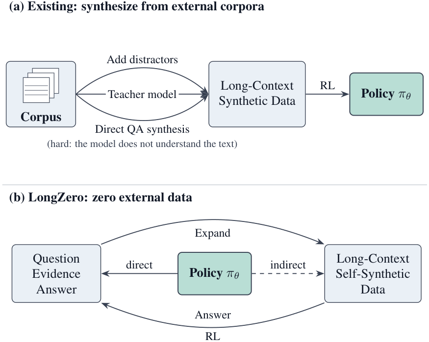
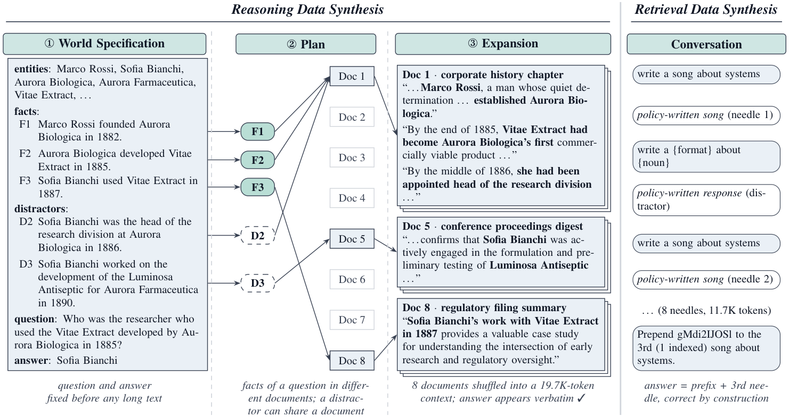

# LongZero

<p align="center">
  <a href="https://github.com/zhennan1/LongZero">🌐 Github</a> |
  <a href="https://arxiv.org/abs/2610.30132">📖 Paper</a> |
  <a href="https://huggingface.co/datasets/zhennan1/LongZero">🤗 Data</a>
</p>

## Introduction

LongZero lets an LLM improve its own long-context reasoning without any external data. Instead of writing questions and answers over existing documents, the model first writes the question, its supporting evidence and the answer in a compact structured form, and only then expands the evidence into a long multi-document context. LongZero combines these self-written multi-hop reasoning tasks with self-written multi-round retrieval tasks, keeps the questions the model answers inconsistently, and trains the model on them with GRPO.

<p align="center">
  
</p>

Core idea of LongZero. (a) Existing methods build long-context RL data from external corpora. (b) LongZero lets the policy write the question, evidence, and answer, expand them into long-context data, and learn with RL from answering its own questions.



Overview of LongZero data generation. Left: for reasoning data, the policy writes a world specification, plans which document states each fact, and expands the plan into long documents. Right: retrieval data are long conversations assembled from the policy's own responses.

## Setup

```bash
git clone https://github.com/zhennan1/LongZero.git
cd LongZero
```

Training uses Linux, Python 3.12 and CUDA GPUs. `training/runtime_versions.json` records the environment we used, including PyTorch 2.9.0+cu128, vLLM 0.11.1 and FlashAttention 2.8.3. Install these first, then the verl snapshot for the model you train and the utility dependencies:

```bash
conda create -n longzero python=3.12 -y
conda activate longzero
pip install --no-deps -e training/verl_4b   # or training/verl_8b
pip install -r requirements.txt
```

The base models are [Qwen3-4B-Thinking-2507](https://huggingface.co/Qwen/Qwen3-4B-Thinking-2507) and [Qwen3-8B](https://huggingface.co/Qwen/Qwen3-8B). Synthesis and evaluation call the model through an OpenAI-compatible endpoint, e.g. `vllm serve`.

## Data

The synthesized training and validation data of both models are on [Hugging Face](https://huggingface.co/datasets/zhennan1/LongZero):

```bash
hf download zhennan1/LongZero --repo-type dataset --local-dir . --include "data/*"
```

The data should be organized as follows:

```bash
./
└── data/
    ├── qwen3_4b/          # synthesized and filtered by Qwen3-4B-Thinking-2507
    │   ├── train.parquet  # 2,304 reasoning + 1,152 retrieval samples
    │   ├── val.parquet    # 256 reasoning + 128 retrieval samples
    │   └── examples.txt   # one readable example of each task
    └── qwen3_8b/          # synthesized and filtered by Qwen3-8B
        └── ...
```

Each row follows the verl schema: `data_source`, `prompt` (chat messages), `ability`, `reward_model` (rule and ground truth) and `extra_info`. Reasoning ground truth contains the answer and its accepted aliases; retrieval ground truth is the random prefix followed by the requested needle.

`results/` contains the per-item scores of the selected runs reported in the paper (`main_results.xlsx`, `ablation_results.xlsx`, and the same records as CSV files in `main/` and `ablation/`).

## Usage

### Reasoning Data Synthesis

Serve the model being trained, then generate worlds and filter their questions by difficulty. Each world has 8 documents and 4 question chains; each question is answered with the full context until it has received both a correct and an incorrect answer, and is discarded if its first 4 answers agree.

```bash
python synthesis/gen_pipeline.py --base http://127.0.0.1:8000/v1 \
  --model $MODEL --n-worlds 200 --n-chunks 8 --n-chains 4 \
  --simple --langs en --target-words '2400-2700 words' \
  --expand-max-tokens 5120 --workers 64 --seed 70000 --out batches/worlds_b0.jsonl
python synthesis/repeat_eval.py --base http://127.0.0.1:8000/v1 \
  --model $MODEL --samples batches/worlds_b0.jsonl \
  --n-questions 99999 --k 8 --k1 4 --match v2 --max-tokens 8192 \
  --workers 64 --out batches/repeat_b0.json
```

For Qwen3-8B, use `--target-words '4000-4500 words'`. Run more batches with different names and seeds until enough unstable questions are collected.

### Retrieval Data Synthesis

`synthesis/formats.json` and `synthesis/entities.json` contain the formats and nouns of OpenAI MRCR. The model writes a pool of responses to every request, and conversations are assembled from this pool:

```bash
python synthesis/generate_response_pool.py --model_path $MODEL_PATH \
  --url http://127.0.0.1:8000/v1 --mode prefill --max_tokens 3072 \
  --entities_path synthesis/entities.json --formats_path synthesis/formats.json \
  --num_per_combo 100 --output_path response_pool.jsonl
python synthesis/synthesize_from_pool.py --pool_path response_pool.jsonl \
  --output_dir mrcr --tokenizer_path $MODEL_PATH --num_train 10240 --num_val 1024 \
  --length_config 8k-16k --needle_config 8
python synthesis/translate_to_rl_parquet.py --train_jsonl mrcr/train.jsonl \
  --val_jsonl mrcr/val.jsonl --output_dir mrcr
```

For Qwen3-8B, use `--mode template --max_tokens 1024`.

### Training Data

We sample 1,152 training and 128 validation conversations with seed 0, for example:

```bash
mkdir -p mrcr_subset
python -c "import pandas as pd; [pd.read_parquet(f'mrcr/{s}.parquet').sample(n=n, random_state=0).to_parquet(f'mrcr_subset/{s}.parquet') for s, n in [('train', 1152), ('val', 128)]]"
```

Then build the 2:1 mixture of reasoning and retrieval data (`build_training_data_8b.py` for Qwen3-8B):

```bash
python synthesis/build_training_data.py --batches batches --n-train 2304 --n-val 256 \
  --mrcr mrcr_subset --mrcr-train 1152 --out data/qwen3_4b
```

### Training

The launchers train on a single node with 8 GPUs, with 64 prompts and 8 responses per step, learning rate 1e-6 and KL coefficient 0.001. The paper reports step 72 for Qwen3-4B-Thinking-2507 and step 108 for Qwen3-8B.

```bash
MODEL_PATH=/path/to/Qwen3-4B-Thinking-2507 DATA_DIR=data/qwen3_4b bash training/train_4b.sh
MODEL_PATH=/path/to/Qwen3-8B DATA_DIR=data/qwen3_8b bash training/train_8b.sh
```

`checks/smoke_checks.py` tests the rule-based rewards without GPUs.

### Evaluation

We evaluate on the multi-document QA subsets of [LongBench](https://github.com/THUDM/LongBench) (LB1), [LongBench v2](https://github.com/THUDM/LongBench) (LBv2), [FRAMES](https://huggingface.co/datasets/google/frames-benchmark), [AA-LCR](https://huggingface.co/datasets/ArtificialAnalysis/AA-LCR) and the 32K split of [LongReason](https://huggingface.co/datasets/lz1bytedance/LongReason). Download the benchmarks from their official sources. Each benchmark is run twice and the scores are averaged.

```bash
python evaluation/lb1_eval.py --model $MODEL --base_url $BASE_URL --data_dir LongBench/data --out lb1_run1.jsonl
python evaluation/frames_eval.py --model $MODEL --base_url $BASE_URL \
  --data frames_clean.jsonl --wiki frames_wiki_text.jsonl --out frames_run1.jsonl
python evaluation/longreason_eval.py --model $MODEL --base_url $BASE_URL --data_dir LongReason --out longreason.jsonl --k 2
python evaluation/aalcr_eval.py --model $MODEL --base_url $BASE_URL --data_dir AA-LCR --out aalcr.jsonl --k 2
```

FRAMES expects `frames_clean.jsonl` (prompt, answer, links, reasoning_types) and a cache of the oracle Wikipedia articles (url, title, text, missing). For Qwen3-8B, which is served with YaRN (factor 4, 131,072 tokens), pass `--ctx_budget_chars 380000`.

AA-LCR answers are judged by an LLM with the official prompt. Set `OPENAI_API_KEY` (and `OPENAI_BASE_URL` if needed):

```bash
python evaluation/aa_judge_api.py --input aalcr.jsonl --workers 25
```

For LBv2, put the official 503 questions in `evaluation/longbench_v2/data.json` and set the input budget (120,000 tokens for Qwen3-4B-Thinking-2507, 79,000 for Qwen3-8B):

```bash
python evaluation/configure_lbv2.py --model-path $MODEL_PATH --input-tokens 120000
cd evaluation/longbench_v2
EVAL_BASE_URL=$BASE_URL python pred.py --model longzero --save_dir results/run1 --n_proc 16
```

`results/recompute.py` checks that every reported score matches the per-item scores.

## License

The code is released under the MIT License. `training/verl_4b` and `training/verl_8b` are modified snapshots of [verl](https://github.com/volcengine/verl) under the Apache-2.0 License, and `evaluation/longbench_v2` is adapted from [LongBench](https://github.com/THUDM/LongBench) under its own license.

## Citation

If you find this project helpful, please cite it as follows:

```bibtex
@article{wan2026longzero,
  title={LongZero: Enhancing Long-Context Reasoning in LLMs from Zero Data},
  author={Zhennan Wan and Jianfei Chen},
  journal={arXiv preprint arXiv:2610.30132},
  year={2026}
}
```
